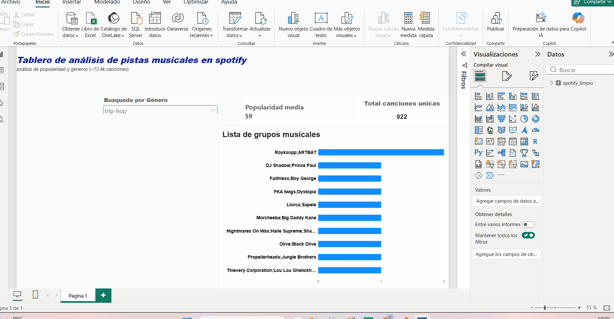

# 🎵 Spotify Track Analytics Dashboard

> Un dashboard interactivo de Business Intelligence desarrollado en Power BI para analizar un dataset de más de **72,400 canciones de Spotify**, enfocado en la exploración de popularidad por género y el comportamiento de los artistas principales.

---

## 📊 Vista Previa del Dashboard

---

## 🎯 Objetivos de Negocio & Métricas Clave

El reporte responde a preguntas clave de análisis exploratorio (EDA):

* **¿Cuál es el volumen real de canciones únicas** en el ecosistema analizado?

* **¿Cómo se distribuye la puntuación de popularidad (0-100)** a nivel global y filtrada por género?

* **¿Qué artistas lideran el Top 10** en términos de presencia e impacto en las reproducciones?

### KPIs Principales (Calculados mediante DAX):

1. **Distinct Track Count:** Recuento único de canciones para evitar duplicados en el modelo.

2. **Average Popularity Score:** Puntuación promedio normalizada en la escala oficial de Spotify (0-100).

---

## 🛠️ Stack Tecnológico & Proceso Técnico

* **Herramienta:** Power BI Desktop.

### 1. Ingesta y Limpieza de Datos (Python & Pandas)
* **Dataset Source:** Archivo CSV masivo (~72.4k registros de Spotify).

* **Procesamiento:** Se utilizó **Python** y la librería **Pandas** para:

  * Inspección inicial de nulos, tipos de datos y duplicados.
  * Normalización de columnas de texto (géneros y nombres de artistas).
  * Optimización de estructuras de datos antes de importarlas al modelo de BI.

### 2. Modelado y Limpieza:

  * Depuración de referencias cruzadas y manejo de cardinalidad para garantizar la integridad de las métricas.
  * Configuración avanzada de interactividad (Filtros cruzados y segmentación dinámica por Slicer de género).

* **Diseño UI/UX :**

  * Estructura limpia basada en tarjetas KPI macro, alineación simétrica y jerarquía visual clara.
  * Nomenclaturas explícitas en etiquetas y visuales para una lectura inmediata sin fricción.

---

## 🚀 Cómo explorar este proyecto
1. Descarga el archivo [Spotify_Dashboard.pbix](./Spotify.pbix) desde este repositorio.

2. Ábrelo en tu equipo utilizando **Power BI Desktop**.

3. Interactúa con el desplegable de géneros musicales para observar el filtrado en tiempo real sobre el Top 10 de artistas y las tarjetas de métricas.

---
*Desarrollado como parte de mi portafolio profesional en Análisis de Datos & Business Intelligence.*